<h1 align="center">Ahmed Mohamed Al Farjani</h1>

  <b>Electrical &amp; Electronic Engineer — Control Systems</b> 
  Industrial Automation · Electrical Maintenance · Applied Machine Learning

  <a href="mailto:ahmedalfarjani1998@gmail.com">ahmedalfarjani1998@gmail.com</a> ·
  <a href="https://wa.me/218934758359">WhatsApp</a> ·
  Tripoli, Libya

---

I am an Electrical and Electronic Engineering graduate (Control Systems) from Tripoli University, working across industrial automation, electrical systems, and software. My work spans PLC- and ESP32-based control, VFDs, industrial networking, and Python/TensorFlow models for time-series forecasting. I focus on systems that hold up in the field, not just in a notebook.

## About Me

- **BSc Electrical & Electronic Engineering — Control Systems**, Tripoli University (2024)
- Most recently **Automation & Maintenance Engineer** at Nawar Food Industry (Oct 2025 – Jul 2026)
- Hands-on with **PLC, ESP32, Arduino, VFDs (Danfoss, Yaskawa, INVT)**, electrical machines, instrumentation, and FCU systems
- Building **deep learning models for time-series forecasting** with TensorFlow, scikit-learn, and Python
- Building **private TypeScript and AI products**
- Based in **Tripoli, Libya**

## Technical Skills

  <picture>
    <source media="(prefers-color-scheme: dark)" srcset="https://skillicons.dev/icons?i=py%2Ccpp%2Cmatlab%2Cpostgres%2Ctensorflow%2Csklearn%2Carduino%2Cts%2Cgit%2Cgithub&amp;theme=dark&amp;perline=10">
    
  </picture>

**Software & Data:** Python · C++ · MATLAB/Simulink · Assembly · SQL (PostgreSQL) · Git  
**Automation & Electrical:** ESP32 · Omron PLC · Arduino · VFDs (Danfoss, Yaskawa, INVT) · Electrical machines · Instrumentation · FCU systems  
**Networking & IT:** Router and switch configuration · IP addressing · LAN setup and troubleshooting · VPS · CCNA/CCNP  
**AI / Data:** Deep learning for time-series forecasting · Neural networks · LLMs

## GitHub Dashboard

  <picture>
    <source media="(prefers-color-scheme: dark)" srcset="https://raw.githubusercontent.com/ahmedalfarjani/ahmedalfarjani/main/profile/stats-dark.svg">
    
  </picture>
  <picture>
    <source media="(prefers-color-scheme: dark)" srcset="https://raw.githubusercontent.com/ahmedalfarjani/ahmedalfarjani/main/profile/top-langs-dark.svg">
    
  </picture>

  <picture>
    <source media="(prefers-color-scheme: dark)" srcset="https://streak-stats.demolab.com?user=ahmedalfarjani&amp;theme=github-dark-blue&amp;hide_border=true&amp;background=0D1117&amp;stroke=30363D&amp;ring=58A6FF&amp;fire=FF7B72&amp;currStreakNum=C9D1D9&amp;sideNums=C9D1D9&amp;currStreakLabel=58A6FF&amp;sideLabels=8B949E&amp;dates=8B949E">
    
  </picture>

### Contribution Activity

  <picture>
    <source media="(prefers-color-scheme: dark)" srcset="https://raw.githubusercontent.com/ahmedalfarjani/ahmedalfarjani/main/profile/activity-dark.svg">
    
  </picture>

### Isometric Contribution Calendar

  

### Contribution Snake

  <picture>
    <source media="(prefers-color-scheme: dark)" srcset="https://raw.githubusercontent.com/ahmedalfarjani/ahmedalfarjani/output/github-snake-dark.svg">
    
  </picture>

### GitHub Achievements

  <picture>
    <source media="(prefers-color-scheme: dark)" srcset="https://trophygithubreadmelang.cybee.dpdns.org/?username=ahmedalfarjani&amp;theme=darkhub&amp;no-bg=true&amp;no-frame=true&amp;column=4&amp;rank=SECRET%2CSSS%2CSS%2CAAA%2CAA%2CA%2CB%2CC&amp;margin-w=8&amp;margin-h=8">
    
  </picture>

## Featured Repositories

  <a href="https://github.com/ahmedalfarjani/Deep-Learning-for-time-series-forecasting-on-Carbon-Dioxide">
    <picture>
      <source media="(prefers-color-scheme: dark)" srcset="https://raw.githubusercontent.com/ahmedalfarjani/ahmedalfarjani/main/profile/pin-deep-learning-dark.svg">
      
    </picture>
  </a>
  <a href="https://github.com/ahmedalfarjani/InvenTree">
    <picture>
      <source media="(prefers-color-scheme: dark)" srcset="https://raw.githubusercontent.com/ahmedalfarjani/ahmedalfarjani/main/profile/pin-inventree-dark.svg">
      
    </picture>
  </a>

**CO₂ Emissions — Time-Series Forecasting** · `Python` `TensorFlow` `scikit-learn`

A deep learning pipeline for forecasting CO₂ indicators across Brazil, India, China, South Africa, the United States, the United Kingdom, the World, and the EU. It uses an 80/20 chronological split, per-region feature and target scaling, and a feed-forward Keras network (3 × 100 ReLU units) trained per region, with MAPE used to evaluate fit and overfitting.

[View repository →](https://github.com/ahmedalfarjani/Deep-Learning-for-time-series-forecasting-on-Carbon-Dioxide)

**InvenTree (fork)** · `Python` `Django`

A fork of the open-source inventory management system. The original project is maintained by the InvenTree team.

[Upstream project →](https://github.com/inventree/InvenTree)

**Private repositories** · `TypeScript`

- `LibyanExits`
- `LibyanExit`
- `dental-clinic-ai-receptionist`

Private product and AI projects. Source is not public.

## Experience

| Role | Organization | Period |
|------|--------------|--------|
| Automation & Maintenance Engineer | Nawar Food Industry | Oct 2025 – Jul 2026 |
| Customer Service Support | Almadar Aljadid | Jan 2025 – Dec 2025 |
| Technical Assistant (Part-time) | Aliairtiqa | Aug 2023 – Sep 2023 |
| Data Entry Operator / Sales Engineer (FCU Systems) | Jalid Al Abyad | Aug 2021 – Apr 2022 |
| FCU Systems Installation Technician | DAIKIN – Al Khebra Group | Oct 2020 – Nov 2020 |

## Education & Certifications

| Credential | Issuer | Year |
|------------|--------|------|
| BSc Electrical & Electronic Engineering — Control Systems | Tripoli University | 2024 |
| Certificate — Central Air Conditioning | Libyan-Korean Center | Dec 2020 |
| Certificate — Security Camera Systems | Oya Academy | Apr 2020 |

## GitHub Milestones

- Joined GitHub in **November 2024**
- First public repository (fork) in **January 2026**
- First original public repository in **July 2026**
- **2 public repositories**; private work is excluded from public stats unless enabled in profile settings

## Contact

| Channel | Details |
|---------|---------|
| Email | [ahmedalfarjani1998@gmail.com](mailto:ahmedalfarjani1998@gmail.com) |
| WhatsApp | [+218 93 475 8359](https://wa.me/218934758359) |
| Location | Tripoli, Libya |
| GitHub | [@ahmedalfarjani](https://github.com/ahmedalfarjani) |

Statistics are generated from GitHub data and refreshed automatically by GitHub Actions.

